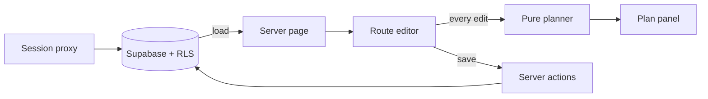

# Architecture

Next.js App Router, TypeScript, React, Tailwind, and Supabase Auth/Postgres. The browser computes plans; server components load routes and server actions persist them.



## Boundaries

| File | Responsibility |
| --- | --- |
| `lib/engine.ts` | Timing, daylight, checkpoint, formatting |
| `lib/prose.ts` | Deterministic example-format parser |
| `lib/validation.ts`, `lib/dates.ts` | Persistence schemas and input completeness |
| `app/routes/[id]/RouteEditor.tsx` | Editing, saving, unsaved warnings, tab-local recovery |
| `app/routes/[id]/ProseInput.tsx` | Parse preview and confirmed segment replacement |
| `app/routes/[id]/PlanPanel.tsx` | Controls, recommendations, warnings |
| `app/actions.ts` | Authentication and route mutations |
| `proxy.ts`, `lib/supabase/server.ts` | Session refresh and authenticated database access |
| `supabase/migrations/` | Versioned database schema |

`/` redirects to `/login`; authenticated visitors continue to `/routes`. Missing or inaccessible route IDs return 404. Saves verify that a row was updated.

## Scope decisions

- Store ordered segments as JSON and save once per route to keep persistence simple.
- Insert the sample from `lib/sample-route.ts` instead of maintaining template tables or seed data.
- Use up/down controls for reordering and four terrain types; scrambling uses off-trail rates.
- Prioritize the auth → edit → plan → save loop. AI intake comes next; trip logging and calibration follow.

## Data and editing

Each `routes` row stores its owner, name, coordinates, elevation, derived IANA timezone, ordered segments (`jsonb`), plan date, description, party size, storm cutoff, and margin. Defaults are party size 2, storm cutoff 14:00, and margin 60 minutes. Four owner-only RLS policies protect CRUD operations. Demo users share one account and its routes.

Segments stay in one JSON array: reordering is an array swap and saving is one update. Zod validates writes; database constraints bound route fields. Incomplete drafts may be saved, but the editor suppresses recommendations until required measurements are present. Numeric coercion keeps intermediate edits from producing `NaN` clocks.

Dates default to tomorrow in the route's timezone. Server initialization avoids hydration differences. Clearing the date retains the last valid plan. Same-tab session storage provides best-effort recovery; server Save is the durable copy.

## Timing model

| Terrain | Assumed duration |
| --- | --- |
| Trail | `(km + verticalM / 100) / rate` hours; rate 4 up, 6 down |
| Off-trail / scrambling | Same formula; rate 2 up, 3 down |
| Pitches | 30 / 45 / 60 minutes by numeric YDS grade band |
| Rappels | 15 minutes each |

Rope durations multiply by `1 + 0.5 × max(0, partySize − 2)`; walking does not. Missing rope count defaults to one. Unreadable grades use 45 minutes and raise a warning. Numeric grade parsing preserves `5.9 < 5.10a`; letter suffixes do not create additional time bands.

The checkpoint is the end of the last exposed segment, falling back to the last ascent. With `throughCheckpoint` as elapsed time through that point, `remaining` as the ordered remainder, and `lastLight = nauticalDusk − margin`:

```text
start      = min(stormCutoff − throughCheckpoint, lastLight − totalTime)
checkpoint = min(stormCutoff,                     lastLight − remaining)
```

Prefix sums matter on interleaved traverses: descents before the checkpoint count toward exposure, and later climbs count toward the remaining route. A forward pass produces segment clocks consistent with departure. The checkpoint is an itinerary deadline, not a reverse-route bailout calculation.

Clock math uses local minutes since midnight. Negative values refer to earlier days and trigger a bivy warning. SunCalc receives elevation and the date-specific UTC offset; missing dusk removes the darkness term. Keep SunCalc's bundled nullable types. `tz-lookup` derives the stored timezone from validated coordinates and can be approximate near zone borders.

## Extensions

The [README roadmap](README.md#next-ai-assisted-route-intake) covers AI translation and route-link intake. The active endpoint returns 501; AI adapters and quotas are not connected to the UI.

Later pace calibration can use the engine's optional per-terrain factors. Proposed trip logs store segment terrain, base predicted minutes, and actual minutes; a factor of `(2 + Σ actual hours) / (2 + Σ predicted hours)` supplies a two-hour prior against overreacting to one trip. A future pace page would compare predictions with actuals and show per-terrain factors. Trip logging and calibration are not implemented.

Automatic keep-alive/availability monitoring is also deferred; verify the hosted app before a demo.

Setup, verification commands, and the sample walkthrough live in [README](README.md). Hosting status and acceptance checks live in [DEPLOY](DEPLOY.md).

## AI integration (deferred)

- `lib/bedrock.ts`: Vercel AI SDK structured extraction via `@ai-sdk/amazon-bedrock`, with existing draft validation, source checks, and deterministic unit conversion. Requests have a 20-second deadline, 4,096-token limit, and no retries.
- `lib/agentcore.ts`: `withAgentCoreTools(token, allowedNames, run)` discovers selected tools from a JWT-authorized AgentCore Gateway, passes an AI SDK `ToolSet` to the callback, and closes the MCP client afterward. The callback can pass these tools to `generateText`; it must set its own timeout and step limit.

Set server-only `AWS_REGION` and `BEDROCK_MODEL_ID` (a model or inference-profile ID enabled for that region). Credentials use the AWS Node provider chain, including local profiles and workload roles. The provider also supports `AWS_BEARER_TOKEN_BEDROCK` when configured. Set `AGENTCORE_GATEWAY_URL` to the deployed HTTPS MCP endpoint and supply a fresh access token from its configured identity provider per request. This connector supports JWT authorization; IAM/SigV4 gateway authentication requires a separate transport.

Before enabling AI: provision the model and tools, implement token acquisition and per-user tool authorization, connect quotas to the endpoint, and run live acceptance. CalTopo/AllTrails retrieval, AgentCore Browser/Code Interpreter integration, and tool-assisted route extraction remain unbuilt. Imported source material will need provenance validation before it can feed the extraction adapter, which currently accepts evidence only from the supplied description.

References: [Bedrock provider](https://ai-sdk.dev/providers/ai-sdk-providers/amazon-bedrock), [AI SDK MCP](https://ai-sdk.dev/docs/ai-sdk-core/mcp-tools), [AgentCore Gateway](https://docs.aws.amazon.com/bedrock-agentcore/latest/devguide/gateway-using.html).
