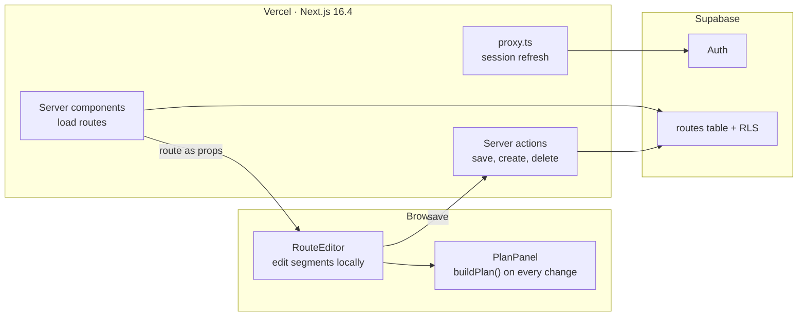

# Alpine Start — Solution Architecture (2-hour cut)

_Oct 9, 2026 · revised Oct 10, 2026 (resolved decisions — see §[Resolved decisions](#resolved-decisions))_

> Implementation update — October 12, 2026: prose entry now parses one segment per line into a reviewable Segment list; the plan date and original prose are persisted. The turnaround/checkpoint deadline uses the ordered remainder after the named exposure anchor, not the sum of all descent phases. The UI identifies that checkpoint and does not claim to estimate a reverse-route bailout. Two versioned migrations now reproduce the schema. These decisions supersede the original two-hour-cut assumptions below where they differ. See README.md and DEPLOY.md for current verification and deployment status.

Alpine Start tells climbers when to leave the car so they summit before afternoon storms and get back before dark.

The 2-hour build ships one complete loop: **sign in → build a route → see a live plan.** Pace learning and the other features come later and double as the README's "what's incomplete" list.

## Phases

| Phase | When | Scope |
| --- | --- | --- |
| **1. Submission** | The 2-hour block | Auth + demo login; routes with segments; planner engine; live plan view; sample Palisades route; deployed |
| **2. Next** | After submission, or live in the interview | Trip logging, pace calibration, pace page, keep-alive cron |
| **3. Extensions** | Interview discussion | Weather-based cutoff, GPX import, sharing, offline PWA |

## Phase 1 architecture



| Layer | Choice |
| --- | --- |
| App | Next.js 16.4 App Router, strict TypeScript, Tailwind; set `cacheComponents: false` (confirm top-level vs. `experimental` in 16.4) |
| Auth + data | Supabase Auth + Postgres + RLS via `@supabase/ssr`; **pin `@supabase/supabase-js`** (see [Caveats](#caveats)) |
| Logic | `suncalc` 2.1.1 for daylight, `tz-lookup` for coordinates → IANA zone, `zod` to validate on save |
| Tests | Vitest, engine only — 5 tests |
| Hosting | Vercel Hobby |

**Do not install `@types/suncalc`.** suncalc 2.1.1 ships its own `index.d.ts`, which types the named times as `Record<SunTimeName, Date | null>`. That union is what makes `strict` catch the polar-day null at compile time; a separate DefinitelyTyped declaration typing them as non-nullable `Date` would shadow it and mask the bug.

### Simplifications vs. the full design

| Full design | Phase 1 | Why |
| --- | --- | --- |
| `segments` table + reorder logic | `segments jsonb` column on `routes` | One table, one RLS policy, reorder is an array swap |
| Template routes + clone | "Add sample route" button inserting a TS constant | No template rules in RLS, no seed SQL |
| Per-segment server actions | One `saveRoute(id, payload)` | Edit locally, plan updates live, save once |
| `date-fns-tz` | All plan math in **local minutes since midnight** | One `toLocalMinutes(date, tz)` helper using `Intl` |
| 6 terrain types | 4: trail, off-trail (incl. scrambling), pitches, rappels | Covers the Palisades traverse |
| Drag-and-drop reorder | Up/down buttons | Minutes instead of a library |
| Timezone picker | Derived from lat/lng at create time | One fewer input, and the worst input in the app |

## Data model (Phase 1)

| Table | Columns | RLS |
| --- | --- | --- |
| `routes` | `id`, `user_id`, `name`, `lat`, `lng`, `elev_m`, `timezone` (IANA, derived), `segments` (jsonb), `party_size`, `storm_cutoff_min`, `margin_min`, `created_at` | Owner-only for all operations |

```sql
party_size       int not null default 2,
storm_cutoff_min int not null default 840,  -- 14:00, local minutes since midnight
margin_min       int not null default 60
```

The three control columns exist because the demo script changes party size and the storm cutoff — they cannot evaporate on reload. **The plan date is persisted:** existing routes without a saved date default to tomorrow in the route timezone. Original prose is saved alongside the parsed segments.

```ts
type Terrain = 'trail' | 'offtrail' | 'pitches' | 'rappels'

type Segment = {
  id: string
  label: string
  terrain: Terrain
  phase: 'ascent' | 'descent'
  km?: number        // trail, offtrail
  vertM?: number     // trail, offtrail
  count?: number     // pitches, rappels — defaults to 1
  grade?: string     // pitches — YDS
  exposed?: boolean  // the storm deadline applies through this segment
}
```

Validated with zod on save. `timezone` is written once by `createRoute` and is thereafter the source of truth — it is not re-derived on render.

## Planner engine (`lib/engine.ts`)

Pure, no framework imports, runs in the browser on every change. **Because it runs on every keystroke, a half-typed field is not an edge case — it is every single edit.** Clearing a numeric input yields `''` / `NaN`, and `Math.min(840 - NaN, …)` is `NaN`, which would render `NaN:NaN` across the whole panel mid-typing. So the engine coerces at its own boundary; zod guards persistence, not arithmetic.

```ts
const num = (v: unknown, fallback = 0): number =>
  typeof v === 'number' && Number.isFinite(v) ? v : fallback
```

| Field | Missing / unparseable |
| --- | --- |
| `km`, `vertM` | `0` |
| `count` | **`1`** — there is always at least one pitch or rappel |
| `grade` | Middle band, flagged `assumed` in the UI (see below) |
| `margin_min` | **`60`** — required in `PlanInput`, defaulted at the call site, never optional |

### Terrain models

| Terrain | Time model | Default |
| --- | --- | --- |
| Trail | Munter: (km + vertM / 100) / rate | Up 4, down 6 |
| Off-trail | Munter | Up 2, down 3 (assumed) |
| Pitches | Minutes per pitch × party factor | 30 / 45 / 60 by band (assumed) |
| Rappels | Minutes per rappel × party factor | 15 (assumed) |

`partyFactor = 1 + 0.5 × max(0, partySize − 2)`, applied **to pitches and rappels only** — walking does not slow with party size, rope work does.

### YDS grade parsing

A three-band lookup over a raw string is wrong in a way that is both silent and dangerous: lexicographically `'5.10a' < '5.6'`, because `'1' < '6'`. That prices a 5.10a pitch at 30 minutes instead of 60 — with six pitches and a party of three, a 4½-hour underestimate, telling you to leave at 08:00 for a day that needs a 03:30 start.

So grades parse to a **comparable number**: the decimal after `5.`, plus a fraction for the letter or sign. Letters order correctly within a number (`5.10a < 5.10b < 5.10c < 5.10d`), and signs order around it (`5.8- < 5.8 < 5.8+`).

```ts
const YDS = /^5\.(\d{1,2})\s*([abcd])?(?:\s*\/\s*[abcd])?\s*([+-])?$/i
const LETTER = { a: 0, b: 0.25, c: 0.5, d: 0.75 } as const

/** 5.9 → 9 · 5.9+ → 9.25 · 5.10a → 10 · 5.10b → 10.25 · 5.10d → 10.75 · 5.11a → 11 */
export function gradeValue(grade?: string): number | null {
  const m = YDS.exec((grade ?? '').trim())
  if (!m) return null                                   // '', '4th class', 'A1', undefined
  const letter = m[2]?.toLowerCase() as keyof typeof LETTER | undefined
  const frac = letter ? LETTER[letter] : m[3] === '+' ? 0.25 : m[3] === '-' ? -0.25 : 0
  return Number(m[1]) + frac
}

export function pitchMinutes(grade?: string): { minutes: number; assumed: boolean } {
  const v = gradeValue(grade)
  if (v === null) return { minutes: 45, assumed: true }
  return { minutes: v <= 6 ? 30 : v < 10 ? 45 : 60, assumed: false }
}
```

The letter never changes the band — a through d all sit in 5.10+. It is parsed because `gradeValue` is the comparable the UI validates and sorts with, and the seam Phase 2 needs when pitch times get finer than three bands. The fractional suffixes fall on the right side of both band boundaries: `5.6+` → 6.25 → 45, `5.7-` → 6.75 → 45, `5.9+` → 9.25 → 45, `5.10a` → 10 → 60.

**The fallback is the middle band, not the fast one.** The errors are not symmetric: underestimating makes you leave too late, which is the failure the product exists to prevent; overestimating makes you leave early, which is merely annoying. Rule: *round toward the slower estimate whenever parsing fails.*

### The two deadlines

The invariant that drives the whole calculation:

> The **dark** constraint depends on the route's **total** time, which is order-independent. The **storm** constraint depends on the time elapsed **up to a point** in the route, which is order-dependent.

`T_up = Σ(ascent segments)` is a phase sum, and treating it as elapsed-time-to-the-summit is only valid when every ascent segment precedes every descent segment — a there-and-back peak. The sample route is the **Palisades Traverse**: several summits with descending in between. With 180 + 120 ascent, then 40 descent, then 60 ascent, then 150 descent, a 14:00 cutoff yields `840 − 360 = 08:00` — but walking the segments in order from 08:00 finishes the last ascent at **14:40**, forty minutes past the cutoff the panel calls binding. The error is exactly the descent time occurring before the anchor — the 40-minute notch descent — and it is unbounded in general. The prefix sum to the anchor is 400, so the correct start is **07:20** and the anchor lands exactly on 14:00.

The fix is a **cutoff anchor**: name the segment the storm deadline applies through, and take a prefix sum to it.

```ts
// Explicit `exposed` flags win; otherwise the last ascent segment,
// which reproduces the there-and-back behaviour exactly.
const lastFlagged = segments.reduce((last, s, i) => (s.exposed ? i : last), -1)
const anchor = lastFlagged >= 0
  ? lastFlagged
  : segments.reduce((last, s, i) => (s.phase === 'ascent' ? i : last), -1)

const throughAnchor = anchor < 0 ? 0 : sum(mins.slice(0, anchor + 1))
const lastLightMin  = duskMin - marginMin

const startStorm = stormCutoffMin - throughAnchor
const startDark  = lastLightMin - totalMinutes

const startMin = darkKnown ? Math.min(startStorm, startDark) : startStorm
const binding: 'storm' | 'dark' = !darkKnown || startStorm <= startDark ? 'storm' : 'dark'
```

The per-segment clock is then a single forward pass from `startMin`, so the headline number and the clock column can no longer disagree — they come from the same traversal.

**The turnaround takes the storm cutoff into account.** `lastLight − T_down` is derived from darkness only, so on a storm-bound day the panel would print a turnaround *later* than the cutoff it just called binding — 15:20 against a 14:00 cutoff in the example above. A climber reads the turnaround as the hard bail time; an 80-minute contradiction sitting beside the binding-constraint label is the one inconsistency a reviewer is guaranteed to find.

```ts
const turnaroundDark = lastLightMin - remainingMinutes
const turnaroundMin  = darkKnown ? Math.min(stormCutoffMin, turnaroundDark) : stormCutoffMin
```

These are genuinely different quantities — the cutoff is "be past the exposure by", the dark figure is "start down by" — so take the `min()` and label which one won, exactly as the start does.

A **negative** start means the previous evening: report a `bivy` warning rather than a nonsense clock time.

### Daylight

```ts
getTimes(date, lat, lng, height = 0, utcOffset)   // suncalc 2.1.1
```

Two parameters retire two caveats from the previous draft:

- **`utcOffset` is in minutes east of UTC**, and supplying it returns *exactly the local calendar day containing `date`* instead of the local solar day from one nadir to the next. The route row carries an IANA `timezone`, so the offset is computable — which removes the `${date}T20:00:00Z` hack and the "revisit for non-US routes" caveat outright. (That hack's numeric error was small — dusk drifts one to three minutes per day — but the correct call is a parameter we are already passing arguments to.)
- **`height` is in metres and applies to every named time**, not just sunrise and sunset: suncalc computes the observer-angle correction once from `height` and adds it to each time's angle, so nautical dusk at −12° does get the route's elevation.

```ts
function utcOffsetMinutes(date: string, tz: string): number {
  const read = (at: Date) => {
    const name = new Intl.DateTimeFormat('en-US', { timeZone: tz, timeZoneName: 'longOffset' })
      .formatToParts(at).find(p => p.type === 'timeZoneName')?.value ?? 'GMT+00:00'
    const m = /GMT([+-])(\d{2}):(\d{2})/.exec(name)
    return m ? (m[1] === '-' ? -1 : 1) * (Number(m[2]) * 60 + Number(m[3])) : 0
  }
  // Fixed point: probe at 12:00Z, correct the instant, re-read. Converges in one
  // pass for every real zone and removes the DST-boundary ambiguity.
  const guess = read(new Date(`${date}T12:00:00Z`))
  return read(new Date(Date.parse(`${date}T12:00:00Z`) - guess * 60_000))
}
```

**Guard the null.** suncalc 2.1.1 returns `null` — not `Invalid Date` — when the sun never reaches an angle on that day, and sets `alwaysUp` / `alwaysDown` to say which. Unguarded, `toLocalMinutes(null, tz)` throws a `TypeError` in a client component on every keystroke, so this is a hard crash rather than a bad number. When dusk is absent, drop the dark term, force `binding: 'storm'`, and warn:

```ts
export function daylight(date: string, tz: string, lat: number, lng: number, elevM: number): {
  sunriseMin: number | null
  duskMin: number | null
  alwaysUp: boolean
  alwaysDown: boolean
}
```

### Public surface

```ts
type TerrainFactors = Partial<Record<Terrain, number>>   // Phase 2 calibration seam

segmentMinutes(seg: Segment, partySize: number, factors?: TerrainFactors): number
gradeValue(grade?: string): number | null
pitchMinutes(grade?: string): { minutes: number; assumed: boolean }
toLocalMinutes(d: Date, tz: string): number
daylight(date, tz, lat, lng, elevM): { sunriseMin, duskMin, alwaysUp, alwaysDown }
buildPlan(input: PlanInput): Plan
```

The optional third parameter on `segmentMinutes` costs nothing now and means Phase 2 calibration multiplies a factor in without changing a tested signature.

**`PlanInput` is the route as described** — the segment list plus the party and deadline controls. **`Plan` is that description resolved to clock times**: the departure time, the turnaround, the per-segment clock, and which deadline binds. They are the contract between the engine and `PlanPanel`, the two files written in the tightest block, so they are fixed here rather than negotiated at the keyboard.

```ts
type PlanInput = {
  date: string            // 'YYYY-MM-DD', local to the route; defaults to tomorrow
  timezone: string        // IANA, from the route row
  lat: number; lng: number; elevM: number
  segments: Segment[]
  partySize: number
  stormCutoffMin: number  // local minutes; 14:00 = 840
  marginMin: number       // 60 at the call site — required, never optional
}

type SegmentPlan = {
  segmentId: string
  label: string
  minutes: number
  startMin: number        // may be negative
  endMin: number
  assumedGrade: boolean
}

type Plan = {
  segments: SegmentPlan[]
  startMin: number        // negative = the previous evening
  turnaroundMin: number
  binding: 'storm' | 'dark'
  upMinutes: number
  downMinutes: number
  totalMinutes: number
  anchorSegmentId: string | null
  sunriseMin: number | null
  duskMin: number | null
  headlampMin: number     // max(0, sunriseMin - startMin), 0 when sunrise is unknown
  warnings: ('bivy' | 'no-dusk' | 'polar-day' | 'assumed-grade')[]
}
```

`binding` and `warnings` are the product, not implementation detail — they are what tells a climber what to *do* about the answer.

**Five tests:**

1. 5 km + 1,000 m of trail ascent = 3.75 h — pins the Munter formula: `(5 + 1000/100) / 4`.
2. One storm-bound and one dark-bound start — pins the `min()` and the binding-constraint report.
3. `toLocalMinutes` for a known instant in `America/Los_Angeles` — pins the timezone conversion.
4. **Grade ordering and banding** — `5.9 < 5.10a < 5.10b < 5.11a`, and `5.9 → 45`, `5.10a → 60`, `''` → 45 flagged `assumed`. This is the silent-wrong-number path, so it gets a test even in a 2-hour build.
5. **Interleaved traverse** — the five-segment example above: start 07:20, anchor ends exactly 14:00, clock column agrees with the headline. The phase-sum version starts 08:00 and overruns to 14:40, so this test fails against the bug it exists to catch.

Tests 4 and 5 are the two to drop if the clock runs out.

## Pages and actions (Phase 1)

| Path | Shows | Actions |
| --- | --- | --- |
| `/` | — | `redirect('/login')` |
| `/login` | Sign in, sign up, "Try the demo" | `signIn`, `signUp`, `signInDemo`, `signOut` |
| `/routes` | Your routes, new-route form, "Add sample route" | `createRoute`, `addSampleRoute`, `deleteRoute` |
| `/routes/[id]` | Segment editor beside the live plan (date, party size, cutoff, margin) | `saveRoute` |

`/login` redirects to `/routes` when a session already exists, so the root path is correct for both states.

**`createRoute` inputs:** name, latitude, longitude, elevation in metres. **The timezone is derived, not asked** — `tzlookup(lat, lng)` returns an IANA string synchronously and offline from a 152 KB table. It throws on `NaN` or out-of-bounds coordinates, so zod validates the ranges *before* the call, and the result is written to the `timezone` column once.

**`saveRoute(id, { segments, partySize, stormCutoffMin, marginMin })`** — still one action and one save, now carrying the controls that the demo script changes.

**`/routes/[id]` must call `notFound()`.** RLS does not raise an authorization error for another user's route; it filters the row out, so the select returns zero rows and `.single()` errors. Passing that straight through renders the editor over `undefined` and crashes. A 404 is also the right answer — it leaks less than a 403 — but only if it is handled.

**`proxy.ts`** matches `/routes/:path*` and excludes `/login`, `/_next`, and static assets. Getting the matcher wrong is a redirect loop, and it lands in the 0:00–0:20 block where the first production deploy is also happening — a bad place to debug.

```
app/page.tsx                  # redirect to /login
app/login/page.tsx
app/routes/page.tsx
app/routes/[id]/page.tsx      # loads route → <RouteEditor/> + <PlanPanel/>
app/actions.ts                # all server actions
app/layout.tsx + globals.css
lib/engine.ts + engine.test.ts
lib/sample-route.ts
lib/supabase/{server,client}.ts
proxy.ts
supabase/schema.sql
next.config.ts · vitest.config.ts · .env.local.example
```

**Auth:** email and password with confirmation off. Create the demo user in the Supabase dashboard; put its credentials in the README. Verify users with `getClaims()` — see [Caveats](#caveats).

## 2-hour plan

The resolved decisions add roughly 30 minutes of engine and plumbing work against the previous draft. That is bought back from debugging, not from nothing, so the cut line moves to 1:45 and polish compresses.

| Time | Work |
| --- | --- |
| 0:00–0:20 | Scaffold, Supabase auth + `proxy.ts` + matcher, login page, root redirect, **deploy and sign in on production** |
| 0:20–0:30 | `routes` table + RLS incl. the three control columns, demo user (set `DEMO_*` on Vercel immediately), sample route constant |
| 0:30–1:10 | Engine + 5 tests — grade parser, cutoff anchor, `utcOffset` helper, null guard |
| 1:10–1:45 | Routes list, create form with timezone derivation, editor, live plan panel |
| **1:45 cut line** | Core loop must work on production |
| 1:45–1:55 | Polish: binding-constraint message, headlamp hours, bivy warning, assumed-grade tag, empty and error states |
| 1:55–2:00 | README note (works / incomplete / run), final deploy, private-window test, search for the canary phrase |

**If behind at 1:45,** drop in this order: tests 4 and 5; the `exposed` checkbox in the editor (the `phase === 'ascent'` default already produces correct there-and-back answers); the assumed-grade tag.

**If ahead at 1:45,** add a `trips` table (actuals as jsonb) and a log form. Leave calibration for Phase 2.

## Resolved decisions

Twelve things that were ambiguous or wrong in the first draft, settled before the clock starts.

| # | Decision |
| --- | --- |
| 1 | Grades parse to a comparable number with letter and sign suffixes; bands derive from it |
| 2 | Unparseable grade → middle band (45 min), flagged `assumed`; round toward slower when unknown |
| 3 | `margin_min` defaults to **60** and is required in `PlanInput` |
| 4 | `count` defaults to **1**; `km` / `vertM` default to 0; coercion happens at the engine boundary |
| 5 | `PlanInput` / `Plan` typed in full — the engine ↔ `PlanPanel` contract |
| 6 | Storm deadline uses a **prefix sum through a cutoff anchor** (`exposed?`, defaulting to the last ascent segment), not a phase sum |
| 7 | Turnaround/checkpoint is `min(stormCutoffMin, lastLight − remainingAfterAnchor)`, at the named anchor |
| 8 | `party_size`, `storm_cutoff_min`, `margin_min`, `plan_date` and original prose persisted |
| 9 | Timezone derived from lat/lng via `tz-lookup` at create time; never an input |
| 10 | `/` redirects to `/login`; `/login` redirects to `/routes` when a session exists |
| 11 | suncalc called with `utcOffset` (minutes east of UTC); `null` dusk guarded, not assumed `Invalid Date` |
| 12 | No `@types/suncalc`; `segmentMinutes` takes an optional `factors` argument as the Phase 2 seam |

Still open, deliberately: the file list is not exhaustive of config files, and there are no DB-level CHECK constraints — zod at the action is the only validation layer.

## Phase 2 (next)

| Item | Design |
| --- | --- |
| Trip log | `trips`: `id`, `user_id`, `route_id`, `trip_date`, `party_size`, `actuals` jsonb of `{ segmentId, terrain, predictedMin, actualMin }`; store the base prediction at log time |
| Calibration | Per-terrain factor = (2 + Σ actual h) / (2 + Σ predicted h); passed to `segmentMinutes` as `factors` |
| Pace page | Factor per terrain, predicted vs. actual per trip |
| Keep-alive | Daily Vercel cron running one `select` |

## Caveats

| Risk | Phase 1 handling |
| --- | --- |
| Supabase pauses free projects after 7 idle days | Sign in to the app every few days until the interview; the cron is Phase 2 |
| Prod auth misconfigured | Deploy at 0:20; set the Site URL; test in a private window |
| `getClaims()` is version- and key-dependent | Needs a recent `@supabase/supabase-js`, and local verification needs the project on asymmetric JWT signing keys — on the legacy shared secret it falls back to a network round trip, in the proxy, on every request. Pin the version, check which keys the project has, keep `getUser()` as the fallback |
| Shared demo account | Every demo visitor sees and can delete every other visitor's routes, including during the interview. Accepted at this scale — stated here so it is a choice, not a surprise |
| `tz-lookup` is approximate near zone borders | Lossy compression for file size; irrelevant at Sierra longitudes, and `timezone` is a stored column that can be corrected |
| Assumed defaults | Label them in the UI; calibration fixes them in Phase 2 |
| Next.js security release due Oct 14, 2026 | If submitting after, run `npm i next@latest` and redeploy |
| README written ahead of the code | The status line currently asserts Phase 1 is complete and deployed, with `<deployed-url>` placeholders. Rewrite it from what actually shipped before submitting |
| README canary instruction | Review AI-generated code; search for the phrase before submitting |
| Prep before the clock | Accounts and reading only; write code inside the 2 hours |

Retired from the previous draft: the daylight date-edge-case caveat (fixed by `utcOffset`) and the non-US-routes caveat (same fix).

## Sources

- [Next.js 16.4 release notes](https://nextjs.org/blog/next-16-4)
- [Supabase: SSR client](https://supabase.com/docs/guides/auth/server-side/creating-a-client)
- [Supabase: project pausing](https://supabase.com/docs/guides/platform/free-project-pausing)
- [SunCalc](https://github.com/mourner/suncalc) — `getTimes(date, lat, lng, height = 0, utcOffset)`, verified against 2.1.1
- [tz-lookup](https://www.npmjs.com/package/tz-lookup) — 6.1.25, synchronous, offline
- [Munter rates (Uphill Athlete forum)](https://uphillathlete.com/forums/topic/ua-forum-input-into-training-peaks-feature-request/)
